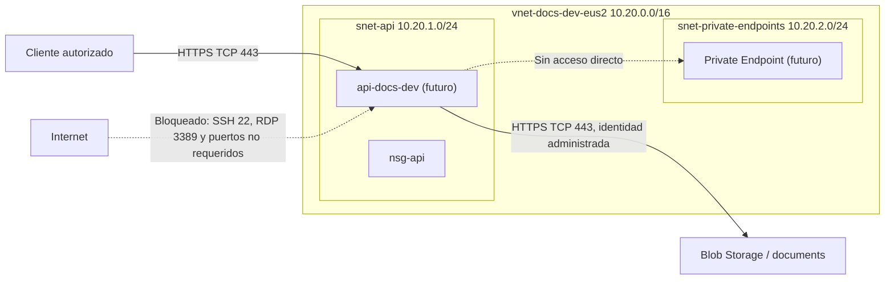

# Entrega del capítulo 1. Diseño del entorno base en Azure

## Alcance y supuestos

Esta propuesta define únicamente el entorno `dev` para la API de documentos.
No crea recursos ni contiene credenciales. Se asume que el tenant de Microsoft
Entra ID pertenece a la organización del equipo y que existe una suscripción
de desarrollo separada de cualquier suscripción de producción.

La región propuesta es **East US 2**. Se elige como hipótesis inicial por su
catálogo amplio de servicios y, normalmente, precios competitivos; la latencia
para los usuarios finales no está medida y debe verificarse. La elección no
confirma requisitos de residencia de datos: antes de crear recursos se debe
validar que la organización permita almacenar documentos en Estados Unidos y
que Storage Account, VNet y los servicios futuros estén disponibles allí.

## 1. Resumen de decisiones

| Aspecto | Decisión | Justificación |
|---|---|---|
| Tenant | Tenant corporativo de Microsoft Entra ID (supuesto) | Centraliza identidades, grupos e identidades administradas. No se crea un tenant por entorno. |
| Entorno | `dev` | Permite probar la API y eliminar sus recursos sin afectar producción. |
| Suscripción | `sub-azure-dev` (nombre lógico; ID real pendiente) | Separa facturación, cuotas y gobierno del entorno productivo. Antes de operar se debe confirmar la suscripción activa. |
| Región | `East US 2` (hipótesis) | Se prioriza disponibilidad esperada y costo; se debe confirmar latencia, residencia de datos, cuotas y redundancia requerida. |
| Grupo de recursos | `rg-docs-dev-eus2` | La API futura, su almacenamiento y la red de este entorno tienen un ciclo de vida de desarrollo y pueden eliminarse juntos. Producción no pertenece a este grupo. |
| Estándar de nombres | `<tipo>-docs-dev-eus2` | Es legible y diferencia aplicación, entorno y región. Se deben documentar excepciones de servicios con restricciones de longitud o caracteres. |
| Etiquetas | `environment=dev`, `application=document-api`, `owner=equipo-backend`, `costCenter=CC-0000` | Permiten filtrar costos, responsables y recursos. Las etiquetas no conceden permisos ni sustituyen RBAC. |
| Decisión de grupo compartido | Sí para los recursos propios de `dev`; no para recursos compartidos de larga duración | La agrupación se basa en ciclo de vida, no en proximidad. Una red corporativa compartida, si aparece después, tendría otro grupo. |

La suscripción es el límite principal de facturación y gobierno; el grupo de
recursos es un contenedor lógico con ciclo de vida; la región es una ubicación
geográfica; y el tenant administra identidades. Ninguno de estos conceptos
equivale a otro ni convierte automáticamente al grupo en una frontera de
seguridad.

## 2. Inventario de recursos

Los nombres son lógicos y no representan recursos ya creados. La API se
incluye como recurso futuro para hacer explícito el diseño de ciclo de vida;
su despliegue queda fuera de esta actividad.

| Nombre lógico | Tipo | Grupo | Ciclo de vida | Etiquetas | Propósito |
|---|---|---|---|---|---|
| `rg-docs-dev-eus2` | Resource group | Suscripción `sub-azure-dev` | Se crea y elimina con el entorno `dev` | Las cuatro etiquetas estándar | Unidad de organización, costos y limpieza del entorno. |
| `stdocsdeveus2` | Storage Account, nombre sujeto a disponibilidad | `rg-docs-dev-eus2` | Igual que `dev`; conservar antes de eliminar si contiene datos útiles | Las cuatro etiquetas estándar | Proporcionar Blob Storage para documentos y archivos de prueba. |
| `vnet-docs-dev-eus2` | Virtual Network | `rg-docs-dev-eus2` | Igual que la API de `dev` | Las cuatro etiquetas estándar | Espacio privado de direccionamiento y conectividad futura. |
| `snet-api` | Subnet de la VNet | `rg-docs-dev-eus2` | Igual que la VNet | Las cuatro etiquetas estándar cuando el servicio lo admita | Alojar la API futura y su integración de red. |
| `snet-private-endpoints` | Subnet de la VNet | `rg-docs-dev-eus2` | Igual que la VNet | Las cuatro etiquetas estándar cuando el servicio lo admita | Reservar conectividad privada futura para servicios administrados. |
| `nsg-api` | Network Security Group asociado a `snet-api` | `rg-docs-dev-eus2` | Igual que la subnet | Las cuatro etiquetas estándar | Controlar flujos de red explícitamente; no reemplaza autenticación ni RBAC. |
| `api-docs-dev` | Servicio de ejecución de la API (futuro) | `rg-docs-dev-eus2` | Se despliega y elimina con `dev` | Las cuatro etiquetas estándar | Exponer la API REST en capítulos posteriores. No se despliega aquí. |
| `mi-api-docs-dev` | Identidad administrada de la aplicación (futura) | `rg-docs-dev-eus2` | Igual que la API | Las cuatro etiquetas estándar | Autenticar la API ante Blob Storage sin guardar claves en código. |

La cuenta de almacenamiento y la API comparten grupo porque se prueban,
actualizan y eliminan como una unidad de `dev`. La VNet también es propia de
este entorno. Si una VNet pasara a ser compartida por varios equipos o tuviera
un ciclo de vida mayor, se movería a un grupo de red independiente; no se
debería mantener en `rg-docs-dev-eus2` solo por conveniencia.

## 3. Identidades y RBAC

Autenticación identifica al principal; autorización decide qué operación puede
realizar. Azure RBAC aplica autorización principalmente al plano de
administración de recursos. El acceso a los blobs es una autorización de datos
adicional y no se obtiene automáticamente por poder administrar la cuenta.

| Principal | Rol | Alcance | Operaciones permitidas | Por qué es mínimo |
|---|---|---|---|---|
| `grupo-backend-dev` (grupo de Microsoft Entra ID que contiene a la persona desarrolladora) | `Contributor` | Solo `rg-docs-dev-eus2` | Crear, configurar, consultar y eliminar recursos del laboratorio `dev`; no administrar la suscripción ni asignar roles | El trabajo de desarrollo requiere operar varios recursos, pero el alcance no incluye otras aplicaciones, la suscripción completa ni producción. Cuando la infraestructura quede estable, se puede reemplazar por roles específicos de operación. |
| `grupo-backend-dev` | `Storage Blob Data Contributor` | Contenedor `documents` de `stdocsdeveus2` | Leer, crear, actualizar y eliminar blobs de prueba | La persona necesita trabajar con los documentos del entorno, no con todos los contenedores ni con datos de producción. |
| `mi-api-docs-dev` (identidad administrada de la API) | `Storage Blob Data Contributor` | Solo contenedor `documents` de `stdocsdeveus2` | Leer y escribir documentos que la API administra | La aplicación no administra la cuenta, la red ni la suscripción. El alcance se limita al contenedor requerido. Si la API solo leyera, se reduciría a `Storage Blob Data Reader`. |
| `mi-api-docs-dev` | Ningún rol de administración de Azure | Sin alcance de administración | No puede cambiar configuración, claves, firewall o RBAC de la cuenta | Evita confundir el consumo de blobs con la administración del recurso. La aplicación usa su identidad solo para acceso de datos. |

El rol `Contributor` del desarrollador es una concesión acotada al grupo de
recursos, apropiada para un entorno de aprendizaje que debe poder
reconfigurarse. No se concede `Owner` ni `User Access Administrator`, por lo
que la persona no puede delegar permisos. En un entorno real convendría
reemplazarlo por roles separados (por ejemplo, lector y operador de red) tras
conocer las operaciones exactas.

No se usarán claves de cuenta, tokens pegados en el código ni credenciales
compartidas. Para desarrollo local, la persona usaría su identidad de
Microsoft Entra mediante una herramienta autorizada; para la API desplegada,
la identidad administrada `mi-api-docs-dev`.

## 4. Diseño de red

La VNet propone el espacio `10.20.0.0/16`. Las subnets se reservan por función,
aunque el servicio de la API todavía no se despliega. La subnet de endpoints
privados se mantiene separada para que una futura conectividad privada no
mezcle reglas con la API.

### Flujos y reglas NSG

| Prioridad | Dirección | Origen | Destino | Protocolo/puerto | Acción | Motivo |
|---:|---|---|---|---|---|---|
| 100 | Entrada | Clientes autorizados o punto de entrada publicado | `snet-api` / API | TCP 443 | Permitir | Único flujo HTTP seguro de la API. El origen exacto queda pendiente de definir. |
| 110 | Salida | API | Storage Account mediante endpoint público restringido o endpoint privado futuro | TCP 443 | Permitir | Acceso cifrado a Blob Storage; la autorización real la decide RBAC de datos. |
| 200 | Entrada | Cualquier origen de Internet | `snet-api` | TCP 22, TCP 3389 y demás puertos no requeridos | Denegar | No se necesita administración interactiva por SSH/RDP ni exposición accidental. |
| 210 | Entrada | Cualquier origen no autorizado | `snet-api` | TCP 443 | Denegar | Evita que una regla amplia exponga la API; debe ajustarse al punto de entrada elegido. |
| 400 | Salida | API | Destinos no necesarios | Cualquier otro tráfico | Denegar, sujeto a dependencias verificadas | Reduce salida no documentada, sin bloquear prematuramente servicios que Azure requiera para operar. |

Las reglas efectivas y los valores predeterminados de Azure deben comprobarse
en la implementación. Un NSG controla conectividad, no autentica usuarios ni
concede acceso a blobs. El acceso público de la cuenta se deshabilitará; por
eso la ruta de aplicación a almacenamiento se hará con identidad y HTTPS,
preferentemente mediante conectividad privada cuando el diseño de la API lo
confirme.

## 5. Almacenamiento

| Decisión | Propuesta |
|---|---|
| Cuenta | `stdocsdeveus2`, Storage Account de propósito general para Blob Storage; el nombre final debe ser único y cumplir las restricciones del servicio. |
| Datos | Documentos no estructurados, metadatos de archivos de prueba y temporales del entorno `dev`. No se almacenan datos personales reales. Blob Storage no sustituye una base de datos: no aporta por sí solo consultas relacionales ni transacciones de aplicación. |
| Contenedor | `documents`, privado, para documentos administrados por la API. Un contenedor separado, `temp`, podría usarse para pruebas temporales si aparece esa necesidad. |
| Nivel de acceso | `Hot` inicialmente, porque el entorno de desarrollo leerá y escribirá documentos con frecuencia. Se revisará con métricas de uso; no se elige `Archive` sin validar tiempos de recuperación. |
| Redundancia | `LRS` como supuesto de bajo costo para `dev`. Debe cambiarse a una opción con mayor resiliencia si los documentos dejan de ser reproducibles o adquieren requisitos de continuidad. |
| Acceso público | Deshabilitar acceso público de la cuenta y del contenedor. Bloquear cambios a la configuración mediante permisos limitados y una revisión previa. |
| Autorización | Microsoft Entra ID y Azure RBAC de datos: `mi-api-docs-dev` con `Storage Blob Data Contributor` limitado a `documents`; desarrollador con el mismo rol para pruebas. |
| Cifrado y secretos | Mantener cifrado administrado por Azure y no incluir claves, connection strings ni SAS en el repositorio. Si un caso excepcional requiere un secreto, se almacenaría en un gestor de secretos aprobado y con rotación. |
| Retención | Documentos de prueba: 30 días; temporales: 7 días; eliminación o revisión automática debe confirmarse antes de habilitarla. La retención no se aplica a documentos reales sin aprobación del responsable de datos. |

La cuenta puede tener un endpoint de datos técnicamente accesible desde la red,
pero la aplicación seguirá necesitando autorización de datos. Una futura
restricción de firewall o Private Endpoint debe probarse con la ruta real de
la API para no confundir “privado” con “autorizado”.

## 6. Validación, supuestos, límites y riesgos

### Comprobaciones antes de considerar terminado el diseño

1. Confirmar que el tenant de Entra, la suscripción `sub-azure-dev` y el
   usuario/grupo correctos son los objetivos; verificar la suscripción activa
   antes de cualquier comando.
2. Confirmar disponibilidad de Storage Account, Blob Storage, VNet y
   redundancia elegida en `East US 2`, además de cuotas y precios vigentes.
3. Medir latencia desde los usuarios esperados y obtener aprobación de
   residencia/soberanía de datos; cambiar región si la política lo exige.
4. Verificar que `rg-docs-dev-eus2` contiene solo recursos de `dev` y que no
   contiene recursos compartidos o productivos.
5. Validar nombres, las cuatro etiquetas (`environment`, `application`,
   `owner`, `costCenter`) y excepciones de longitud o caracteres.
6. Revisar asignaciones RBAC efectivas: desarrollador sin alcance de
   suscripción/producción y aplicación sin permisos de administración.
7. Probar que el contenedor `documents` no permite acceso anónimo y que la
   identidad de la API solo puede realizar las operaciones previstas.
8. Revisar reglas NSG, rutas y tráfico efectivo; confirmar HTTPS 443 y el
   bloqueo de SSH, RDP y puertos no necesarios.
9. Confirmar política de retención con el responsable de datos y calcular el
   costo esperado de almacenamiento, operaciones, redundancia y tráfico.
10. Registrar la configuración aprobada para que la implementación posterior
    sea reproducible y auditable.

### Supuestos y límites

- La organización tiene una suscripción de desarrollo separada; no se conoce
  su ID real ni su política de cuotas.
- `East US 2`, `LRS`, nivel `Hot` y los bloques CIDR son valores iniciales, no
  hechos verificados.
- La actividad no diseña autenticación de usuarios finales, base de datos,
  CI/CD, observabilidad avanzada ni el despliegue de la API.
- El diseño contempla una API futura; no garantiza todavía que el servicio de
  ejecución elegido en el capítulo 2 soporte exactamente estas subnets y
  reglas.
- La retención propuesta es válida para archivos de prueba, no para
  documentos sujetos a requisitos legales o regulatorios.

### Riesgos pendientes

- **Residencia y latencia:** almacenar en Estados Unidos puede incumplir una
  política de datos o producir latencia inaceptable; requiere confirmación
  legal y medición desde los usuarios.
- **Costo:** redundancia, tráfico de salida, blobs olvidados y reglas de
  retención pueden aumentar el costo; se necesitan presupuesto, alertas y
  revisión de ciclo de vida.
- **Exposición de datos:** habilitar acceso público, compartir una clave o
  ampliar el rol de datos podría exponer documentos; se mitigará con acceso
  privado, identidad administrada, RBAC acotado y revisión de configuración.
- **Pérdida accidental:** eliminar el grupo elimina los recursos de `dev`;
  antes de hacerlo se debe confirmar que no contiene datos que deban
  conservarse y aplicar protección o respaldo si dejan de ser reproducibles.

## 7. Decisiones que requieren confirmación antes de producción

1. **Región, residencia y resiliencia:** el responsable de datos y operaciones
   debe confirmar la región permitida, la latencia objetivo y si `LRS` es
   suficiente o se requiere redundancia zonal/regional. La decisión puede
   cambiar región, costo y arquitectura de red.
2. **Acceso de la identidad de aplicación:** el equipo debe confirmar si la API
   necesita crear, actualizar y eliminar blobs, o solo leerlos. Si no necesita
   escritura/eliminación, se debe reemplazar `Storage Blob Data Contributor`
   por `Storage Blob Data Reader` y mantener el alcance en el contenedor.

